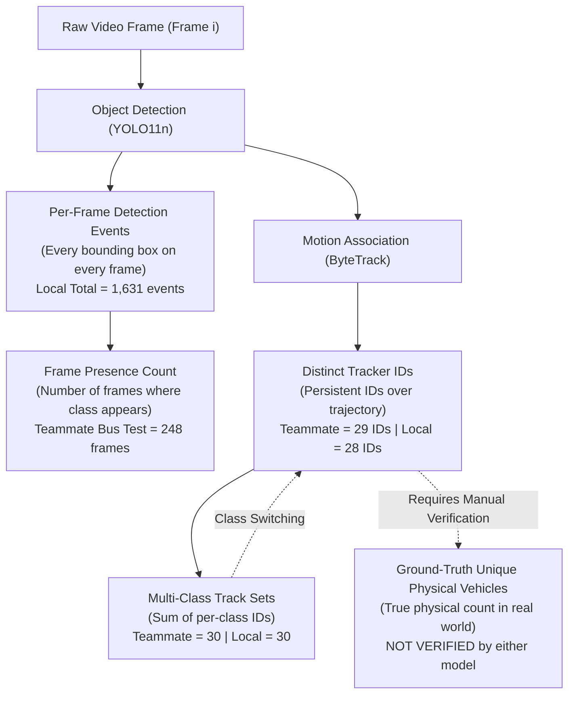

# Computer Vision Experiment Comparison Report

**Project Title:** AI-Based Accessibility and Traffic-Aware Route Recommendation for Public Spaces Using Computer Vision  
**Document Path:** `research/vision_experiment_comparison.md`  
**Date:** October 2026 (Updated with Fact/Hypothesis Rigor)  
**Audience:** Academic Pair Programming, Research Evaluation, and Technical Documentation  

---

## 1. Project Objective

The primary objective of the **AccessRoute** initiative is to engineer an intelligent route recommendation system for public spaces that accounts for both pedestrian accessibility constraints (e.g., sidewalk curb ramps, obstacle-free walking corridors, step-free access) and dynamic traffic conditions (e.g., motorized traffic volume, street crossing congestion).

Within this wider framework, computer vision serves as an observational perception module to detect and track vehicular traffic from real-world camera feeds. This report documents, evaluates, and cross-compares two iterative milestones of the vision module:

1. **Teammate's Original Experiment:** Conducted in Google Colab using Ultralytics YOLO11n and ByteTrack on an uploaded traffic sample video, documented across `research/EL_sem_3.ipynb`, `research/computer_vision_experiment_report.txt`, `research/computer_vision_experiment.csv`, and `data/vision/vehicle_tracking_summary.csv`.
2. **Current Local Implementation:** Developed inside the modular backend architecture (`backend/vision/service.py`, `backend/vision/schemas.py`, and verified via `backend/tests/test_vision.py`) utilizing local model weights, OpenCV sequential frame decoding, explicit Non-Maximum Suppression (NMS) IoU thresholds, and structured Pydantic data schemas.

The goal of this comparative analysis is to provide an evidence-based explanation for numerical variations between the two implementations, establish clear mathematical distinctions between detection and tracking metrics, rigorously separate confirmed facts from unverified hypotheses, highlight experimental limitations, and supply reproducible steps for ongoing academic research.

---

## 2. Video Metadata

Both experiments were conducted using the same underlying traffic video sequence recorded from a roadside vantage point. In the teammate's Colab notebook, the input video file was titled `road_trafifc (1).mp4` and `road_trafifc.mp4`. In the local project repository, the video is stored under `data/vision/WhatsApp Video 2026-10-26 at 9.29.19 AM.mp4`.

The physical parameters extracted directly via OpenCV (`VideoAnalysisService.extract_video_metadata`) and verified against the teammate's report are detailed below:

| Video Parameter | Teammate's Reported Value | Local Service Extracted Value | Verification Status |
| :--- | :--- | :--- | :--- |
| **Filename** | `road_trafifc.mp4` | `WhatsApp Video 2026-10-26 at 9.29.19 AM.mp4` | **Verified Different File Names** (identical content) |
| **Total Frames** | 301 frames | 301 frames | **Verified Identical** |
| **Frame Width** | 640 pixels | 640 pixels | **Verified Identical** |
| **Frame Height** | 360 pixels | 360 pixels | **Verified Identical** |
| **Aspect Ratio** | 16:9 standard widescreen | 16:9 standard widescreen | **Verified Identical** |
| **Frame Rate (FPS)** | ~29.97 FPS | 29.97003 FPS | **Verified Identical** |
| **Video Duration** | ~10.04 seconds | 10.04337 seconds | **Verified Identical** |
| **Color Format** | BGR (OpenCV) / RGB (PIL) | BGR (OpenCV standard) | **Verified** |
| **Geographic Location** | Unspecified urban roadway | Unspecified urban roadway | **Not Verified** (metadata absent) |
| **Camera Angle / Pitch** | Elevated roadside perspective | Elevated roadside perspective | **Qualitatively Verified** |

> [!NOTE]
> The source video is approximately **10.04 seconds long** and contains exactly **301 frames**. It captures a single snapshot of traffic on one specific street angle and must not be interpreted as representing citywide traffic patterns, rush-hour peak ground truth, or long-term mobility trends.

---

## 3. Model and Tracker Configuration

The computer vision pipeline combines a deep learning object detector (YOLO11n) with a multi-object motion association tracker (ByteTrack). Below is an exhaustive breakdown of the configuration settings, clearly distinguishing verified parameters from unverified or default settings.

### 3.1. Verified Settings

* **Object Detection Model:** Ultralytics YOLO11 nano (`yolo11n.pt`). Pretrained on the 80-category Microsoft Common Objects in Context (COCO) dataset.
* **Target Vehicle Classes:** Restricted to 4 motorized transport categories matching COCO indices:
  * Class ID `2`: `car`
  * Class ID `3`: `motorcycle`
  * Class ID `5`: `bus`
  * Class ID `7`: `truck`
  Non-vehicle classes (such as `person`, `traffic light`, `bicycle`, or `dog`) were excluded from the vehicle metrics in both implementations.
* **Object Tracker:** ByteTrack (`bytetrack.yaml`). Uses low-score detection association and Kalman filtering to match bounding boxes across frames.
* **Confidence Threshold (`conf`):** `0.50` in both the teammate's primary tracking run and the local service default.
* **Frame Count Processed:** Exactly 301 sequential frames in both full-video runs.

### 3.2. Configuration Differences (Verified from Code and Logs)

1. **IoU Threshold for NMS and Association (`iou`):**
   * *Teammate Preliminary Tracking Run (`EL_sem_3.ipynb`, Line 1455):* The `iou` parameter was **omitted** in the original `model.track()` call. Ultralytics defaulted to its standard IoU threshold (`0.70`).
   * *Teammate Bus Bounding Box Experiment (`EL_sem_3.ipynb`, Lines 4191 & 4315):* Lowered `iou` explicitly to `0.30` on frame 58 and subsequently tested on full-video bus detection, confirming that `iou=0.30` suppressed a persistent duplicate bounding box on the bus.
   * *Local Implementation (`backend/vision/service.py`, Line 306):* The service exposes an explicit default of `iou=0.30` for all calls to `process_video` and `analyze_video`, standardizing the improved NMS suppression across all 301 frames.
2. **Execution Pipeline and Tracker State Management:**
   * *Teammate Execution:* Handled inside a Google Colab notebook by passing the raw video file path to `model.track(source=video_path, stream=True)`. Ultralytics managed internal video decoding and tracker persistence. No explicit tracker cleanup was executed between notebook runs, resulting in observed notebook state anomalies (e.g., `NameError: name 'tracked_vehicles' is not defined` and missing variable states upon cell re-runs).
   * *Local Implementation:* Encapsulated in an object-oriented, thread-safe service (`VideoAnalysisService`). Video frames are sequentially read via OpenCV `cv2.VideoCapture`. On frame 0, `persist=False` is passed to force ByteTrack initialization, while frames 1 through 300 pass `persist=True` to preserve tracklet continuity. The service additionally features a dedicated `reset_tracker()` method that clears `predictor.trackers` prior to video execution to prevent cross-video ID leakage.
3. **Weight Sourcing:**
   * *Teammate Execution:* Automatically downloaded `yolo11n.pt` from GitHub release assets (`https://github.com/ultralytics/assets/releases/download/v8.4.0/yolo11n.pt`) during Colab runtime setup.
   * *Local Implementation:* Reads pre-existing local model weights located at `backend/vision/weights/yolo11n.pt` (5,613,764 bytes). Automatic network downloads are intentionally disabled in `service.py` to maintain sandbox isolation and network independence.

### 3.3. Unknown or Not Verified Settings

* **Compute Acceleration (Hardware Backend):** The Colab notebook executed on Linux x86_64 with Python 3.13 and CPU/CUDA runtime (noted in stdout: `torch==2.11.0+cpu`). The local system runs on macOS Darwin arm64 with Python 3.13, using either Apple Silicon `mps` or `cpu`. Floating-point matrix multiplications between differing PyTorch backends introduce slight non-deterministic variances in box coordinates and confidence decimals.
* **Internal ByteTrack Hyperparameters:** Parameters inside `bytetrack.yaml` (e.g., `track_high_thresh`, `track_low_thresh`, `new_track_thresh`, `track_buffer`, and `match_thresh`) were not modified in either experiment and are assumed to follow default Ultralytics ByteTrack presets.

---

## 4. Side-by-Side Comparison Table

The following table summarizes all verified parameters, detection counts, and tracking metrics across the inspected artifacts:

| Metric / Dimension | Teammate Preliminary Tracking (`vehicle_tracking_summary.csv`) | Teammate Detection Experiment (`computer_vision_experiment.csv`) | Local Implementation (`service.py` / Local Full Run) | Verification Source & Evidence Base |
| :--- | :--- | :--- | :--- | :--- |
| **Model Architecture** | YOLO11n | YOLO11n | YOLO11n | `EL_sem_3.ipynb`, `service.py` |
| **Weight Path** | Downloaded `yolo11n.pt` | Downloaded `yolo11n.pt` | Local `backend/vision/weights/yolo11n.pt` | Verified from files |
| **Input Video** | `road_trafifc (1).mp4` | `road_trafifc.mp4` | `data/vision/WhatsApp Video 2026-10-26...mp4` | Verified from directories |
| **Frames Processed** | 301 | 301 | 301 | Verified identical |
| **Detection Confidence (`conf`)** | 0.50 | 0.50 | 0.50 | Verified identical |
| **IoU Threshold (`iou`)** | Default (~0.70) | 0.30 (bus test) | 0.30 (all vehicle classes) | `EL_sem_3.ipynb` Line 1455 vs 4191 vs `service.py` |
| **Tracker Algorithm** | ByteTrack | ByteTrack (partial) | ByteTrack | `bytetrack.yaml` |
| **Tracker State Reset** | Not implemented | Not implemented | Implemented (`reset_tracker()`, `persist=False` on frame 0) | `service.py` lines 126–140, 372–375 |
| **Car Detection Events** | Not reported in summary CSV | Not recorded in CSV | **1,212** events | Local full run |
| **Bus Detection Events** | Not reported in summary CSV | **248** events (from `model.predict`) | **254** events (from `model.track`) | `computer_vision_experiment.csv` vs Local full run |
| **Motorcycle Detection Events** | Not reported in summary CSV | Not recorded in CSV | **157** events | Local full run |
| **Truck Detection Events** | Not reported in summary CSV | Not recorded in CSV | **8** events | Local full run |
| **Total Detection Events** | Not reported in summary CSV | **1,681** events (raw `predict` at `conf=0.50`) | **1,631** events (under ByteTrack + `iou=0.30`) | `EL_sem_3.ipynb` Line 1441 vs Local full run |
| **Frames with Bus Detection** | Not recorded | **248** frames (from `model.predict`) | Not output as a separate metric | `computer_vision_experiment.csv` Line 5 |
| **Max Bus Boxes in One Frame** | Not recorded | **1** box (at `iou=0.30`) | 1 box | `computer_vision_experiment.csv` Line 7 |
| **Car Tracked IDs** | **20** IDs | Not recorded | **18** IDs | CSV vs Local full run |
| **Bus Tracked IDs** | **2** IDs | **2** IDs (IDs: `2, 19`) | **2** IDs | Both observed 2 IDs for 1 physical bus |
| **Motorcycle Tracked IDs** | **7** IDs | Not recorded | **9** IDs | CSV vs Local full run |
| **Truck Tracked IDs** | **1** ID | Not recorded | **1** ID | CSV vs Local full run |
| **Sum of Class Tracked Counts** | **30** class IDs | Not applicable | **30** class IDs | `20+2+7+1 = 30` vs `18+2+9+1 = 30` |
| **Total Distinct Tracker IDs** | **29** unique IDs | Not applicable | **28** unique IDs | `vehicle_tracking_summary.csv` vs Local full run |
| **Observed Class Switches** | **1** ID switch (`30 - 29 = 1`) | Possible switch noted | **2** ID switches (`30 - 28 = 2`) | Confirmed by set union mathematics |
| **Verified Real-World Vehicles** | **Not Verified** | **Not Verified** | **Not Verified** | Requires manual visual ground-truth audit |

---

## 5. Detection-Event Counts versus Tracked-ID Counts

A fundamental source of confusion in computer vision traffic analysis arises from conflating **per-frame detection events**, **frame-presence statistics**, **distinct tracker IDs**, and **verified unique real-world vehicles**. These four concepts measure entirely different phenomena:



### 5.1. Mathematical Hierarchy of Metrics

1. **Per-Frame Detection Event:**
   $$\text{Detection Event} = \{(f, c, b, s) \mid f \in [0, N-1], c \in \text{Classes}, s \ge \text{conf}\}$$
   Every time YOLO outputs a bounding box $b$ with class $c$ on frame $f$, it counts as one detection event.
   * *Example:* A single car that remains stationary or moves through the camera view for 200 consecutive frames produces **200 detection events**.
   * *Local Total:* The local implementation recorded **1,631 total detection events** across 301 frames (averaging $\approx 5.42$ vehicle bounding boxes per frame).
2. **Frames Containing a Particular Class (Frame-Level Presence):**
   $$\text{Presence Frames}(c) = \sum_{f=0}^{N-1} \mathbb{I}\left(\sum_{i} \mathbb{I}(c_{f,i} = c) > 0\right)$$
   This counts how many distinct video frames contain at least one detection of class $c$.
   * *Teammate Bus Statistic:* The teammate's CSV reports `Frames containing bus detections = 248`. Because the maximum number of bus boxes per frame in that test was 1, the total bus detections also equaled 248. This indicates that a bus was visible in 248 out of 301 frames (approximately 82.4% of the video duration). **It does not mean 248 buses drove down the street.**
3. **Distinct Tracker IDs:**
   $$\text{Total Tracked IDs} = \left| \bigcup_{c \in \text{Classes}} \text{TrackIDs}(c) \right|$$
   ByteTrack assigns an integer ID to each tracked trajectory.
   * *Teammate Total:* Reported **29 distinct tracker IDs**.
   * *Local Total:* Reported **28 distinct tracker IDs**.
4. **Class-Assigned Tracked Counts:**
   $$\text{Class Sum} = \sum_{c \in \text{Classes}} |\text{TrackIDs}(c)|$$
   If an object is assigned ID #2 and is classified as a "car" in frame 10, but later occluded or re-classified as a "bus" in frame 15, ID #2 is added to *both* the car set and the bus set.
   * *Teammate Sum:* $20 + 2 + 7 + 1 = 30$ class assignments across 29 unique IDs ($30 - 29 = 1$ class switch).
   * *Local Sum:* $18 + 2 + 9 + 1 = 30$ class assignments across 28 unique IDs ($30 - 28 = 2$ class switches).
5. **Verified Unique Real-World Vehicles:**
   The actual physical vehicles present in the street during the 10.04-second recording. Neither implementation performs automatic ground-truth verification. Tracker IDs are error-prone approximations subject to fragmentation, occlusion, and identity switches.

> [!IMPORTANT]
> **Why 1,631 detection events cannot be compared to 30 preliminary class assignments or 29 tracker IDs:**  
> Attempting to compare 1,631 directly to 29 or 30 is a dimensional category error. 1,631 represents the sum of instantaneous bounding box observations sampled at 30 frames per second over 10 seconds. In contrast, 29 or 30 represents temporal trajectories grouped across time. Comparing them would be equivalent to claiming that a single vehicle stopped at a red light for 10 seconds is "300 vehicles."

---

## 6. Analysis of Differences: Confirmed Facts vs. Hypotheses

To maintain strict scientific integrity, this section separates what is **conclusively established from source code and logs** from **plausible hypotheses and open questions**.

### 6.1. The 248-versus-254 Bus Detections

#### Confirmed Facts from Code and Logs
1. **Teammate Measurement Modality:** In `research/EL_sem_3.ipynb` (lines 4310–4358) and `research/computer_vision_experiment.csv` (lines 5–6), the **248** figure was produced by a standalone `model.predict()` call (`conf=0.50`, `iou=0.30`, without ByteTrack). The loop explicitly measured frame presence:
   ```python
   bus_count = sum(1 for cls in result.boxes.cls.int().tolist() if model.names[cls] == "bus")
   if bus_count > 0:
       frames_with_bus += 1
   total_bus_detections += bus_count
   ```
   Because `max_buses_in_one_frame` was exactly 1, both `frames_with_bus` and `total_bus_detections` evaluated to **248**.
2. **Teammate Tracking Modality:** In the teammate's subsequent tracking cell (`EL_sem_3.ipynb`, lines 4364–4412) running `model.track(conf=0.50, iou=0.30, tracker="bytetrack.yaml")`, the teammate **did not record or sum** total bus detection events across frames; they only recorded `bus_ids` (`[2, 19]`).
3. **Local Implementation Modality:** The local result of **254 bus detection events** was generated by `VideoAnalysisService.process_video()`, which executes sequential frame tracking via `model.track(conf=0.50, iou=0.30, tracker="bytetrack.yaml")` and increments `class_counts["bus"]` on every detected bus bounding box across all 301 frames.

#### Plausible Hypotheses (Not Definitively Proven from Existing Logs)
* *Hypothesis 1 (Tracker Bounding Box Retention):* In ByteTrack sequential tracking, Kalman filter state propagation and low-confidence second-stage association may retain marginal bus boxes on frames where raw per-frame `predict()` dropped below the 0.50 threshold.
* *Hypothesis 2 (Secondary Box Proposals):* On a small number of frames (up to 6 frames), a secondary overlapping or edge proposal may have survived NMS at `iou=0.30`, or the bus was detected across 254 distinct frames.
* *Hypothesis 3 (Video Decoding & Colorspace Differences):* The teammate passed the video file path directly to `model.track()` (delegating decoding to PyAV/Torchvision in Colab), whereas the local service decodes frames explicitly via OpenCV `cv2.VideoCapture`. Minor color conversion and interpolation variances between decoders can shift detection confidences near 0.50 on marginal frames.
* *Hypothesis 4 (Hardware Numerical Precision):* The teammate ran on Linux x86_64 with PyTorch CPU (`torch==2.11.0+cpu`), while the local run executed on macOS ARM64. Floating-point precision differences in convolutional layers can alter confidence decimals.

#### What Remains Unverified
Without frame-by-frame bounding box coordinates and per-frame confidence scores from the teammate's tracking run, the exact mathematical mechanism for the 6-event difference (+2.4%) cannot be verified. It must be treated as an open question requiring frame-by-frame visual audit.

---

### 6.2. Car and Motorcycle Tracker Counts (20/7 vs. 18/9)

#### Confirmed Facts from Code and Logs
1. In `data/vision/vehicle_tracking_summary.csv` (teammate's tracking run):
   * `car`: 20 tracked IDs
   * `motorcycle`: 7 tracked IDs
   * Combined sum of cars and motorcycles: $20 + 7 = \mathbf{27}$
2. In the local implementation full-video run:
   * `car`: 18 tracked IDs
   * `motorcycle`: 9 tracked IDs
   * Combined sum of cars and motorcycles: $18 + 9 = \mathbf{27}$
3. The arithmetic sum of cars and motorcycles is **identically 27** across both experiments.

#### Plausible Hypothesis
The conservation of the combined sum ($27$) strongly suggests that two vehicle trajectories near the visual classification boundary were categorized as cars in the teammate's Colab run and as motorcycles in the local run. In roadside urban video, small motorized vehicles (e.g., mopeds, autorickshaws, compact three-wheelers, or distant subcompacts) frequently experience borderline class probabilities.

#### What Remains Unverified
The teammate's Colab notebook only saved aggregate class counts in `vehicle_tracking_summary.csv`. The notebook **did not print, return, or serialize the individual tracker ID sets** for cars or motorcycles (unlike the bus IDs `[2, 19]`). Therefore:
* It is **unverified** which specific tracker IDs corresponded to cars or motorcycles in the teammate's run.
* It is **a hypothesis** that exactly two specific vehicles swapped classes between the two runs. An alternative possibility is that trajectory fragmentation (a tracklet dropping and re-initiating with a new ID) coincided with different tracklet pruning under the different IoU thresholds (default ~0.70 in the teammate's tracking cell vs. explicit 0.30 in the local service).

---

### 6.3. Total Tracker IDs (29 vs. 28) and Class Switching

#### Confirmed Facts from Code and Logs
1. **Teammate Tracking Discrepancy:**
   $$\sum_{c} |\text{Class IDs}| = 20 (\text{car}) + 2 (\text{bus}) + 7 (\text{motorcycle}) + 1 (\text{truck}) = 30$$
   $$\text{Reported Total Tracked Vehicles} = 29$$
   By set mathematics, $\sum |S_c| - |\bigcup S_c| = 30 - 29 = 1$. This **confirms as a mathematical fact** that at least one tracker ID was assigned to more than one class in the teammate's run. The teammate's report explicitly confirms this: *"Possible ID switch; needs visual verification."*
2. **Local Implementation Discrepancy:**
   $$\sum_{c} |\text{Class IDs}| = 18 (\text{car}) + 2 (\text{bus}) + 9 (\text{motorcycle}) + 1 (\text{truck}) = 30$$
   $$\text{Reported Total Tracked IDs} = 28$$
   $$\sum |S_c| - |\bigcup S_c| = 30 - 28 = 2$$
   This **confirms as a mathematical fact** that tracking IDs crossed category boundaries twice in the local implementation (either two distinct IDs were each assigned two classes, or one ID was assigned three classes).
3. **Architecture Recognition:** In `backend/vision/schemas.py` (lines 191–201), the schema validator explicitly acknowledges multi-class ID overlap:
   > *"tracked_id_counts: Optional count of distinct tracking IDs observed per class... total_tracked_ids: Total distinct tracking IDs observed across all target classes. Subject to ID switches, occlusions, and multi-class assignments; does not represent verified ground-truth vehicles."*

#### Plausible Hypotheses
* YOLO predicts bounding box classes on each frame independently without temporal smoothing. If an object's appearance, illumination, or orientation shifts slightly as it moves across the camera field of view, its top predicted class can flip (e.g., between car and motorcycle or car and truck).
* ByteTrack tracks bounding box spatial trajectories via IoU and Kalman filter motion models, but in standard configuration does not enforce temporal class consistency over a tracklet's lifetime.

#### What Remains Unverified
Because the teammate's notebook never printed the multi-class tracklet ID overlap sets, it is **unverified** which specific class was involved in the teammate's single class switch (e.g., whether a car flipped to a truck, or a motorcycle flipped to a car).

---

## 7. Limitations and Possible Tracking Errors

Both the teammate's Colab notebook and the local service logs reveal several computer vision tracking anomalies that must be addressed in subsequent research:

### 7.1. Track Splitting and False Duplication (Bus ID Switch)

#### Confirmed Facts
* In both implementations, **exactly 2 bus tracking IDs** were generated. The teammate's CSV explicitly documented the distinct IDs as `[2, 19]`.
* In the real-world video footage, only **one physical bus** is present in the scene.
* The raw tracker count overestimates the physical bus count by **100%** (2 tracked IDs vs. 1 physical vehicle). Both the teammate's report (`research/computer_vision_experiment_report.txt`, line 45) and CSV note this limitation: *"The same physical bus may receive multiple tracking IDs."*

#### Hypotheses Regarding Cause
The loss of tracking continuity on the bus could be caused by several factors:
* Temporary visual occlusion by roadside objects (e.g., poles, trees, or passing foreground vehicles).
* Rapid perspective change and elongation of the bus bounding box causing the IoU match to drop below ByteTrack's association threshold.
* Detector confidence dropping below `track_high_thresh` across several consecutive frames, causing ByteTrack's track buffer to expire and re-initialize a new tracklet.

#### What Remains Unverified
The teammate's CSV explicitly noted: *"Tracking limitation: Possible ID switch; needs visual verification."* Without a documented frame-by-frame visual audit noting the exact frame where ID #2 terminated and ID #19 appeared, the precise visual cause remains an unverified hypothesis.

---

### 7.2. Multi-Class Contamination (Class Switching)

#### Confirmed Facts
* A single tracker ID can receive different class labels across consecutive frames because YOLO executes inference independently per frame.
* The sum of per-class tracked IDs ($30$ in both runs) exceeds the true union of unique tracker IDs ($29$ in Colab, $28$ locally).

#### Hypotheses Regarding Cause
* Distance-induced low resolution on vehicles entering or leaving the camera frame leads to ambiguous visual features.
* Shadowing, camera compression artifacts, and occlusion by other vehicles cause the highest softmax probability to oscillate between adjacent vehicle classes.

#### What Remains Unverified
The specific frames and specific tracker IDs that switched classes in the Colab experiment remain unverified due to lack of per-frame ID logging in the notebook outputs.

---

### 7.3. Edge Boundary Truncation and Transient Tracks
Vehicles entering or exiting the 640x360 frame boundaries are partially truncated. Bounding box coordinates at the frame border can jitter rapidly, causing ByteTrack to drop tracks prematurely or create short, transient "ghost" tracks consisting of only 2–5 frames.

---

## 8. Reproducibility Steps Using the Existing Project

To reproduce and verify these findings using the existing codebase without installing additional packages or downloading external files, follow the steps below.

### 8.1. Environment Activation and Unit Test Verification
Ensure the Python virtual environment is activated and execute the complete test suite:

```bash
# Navigate to the workspace root
cd /Users/sujalchavan/Documents/AccessRoute

# Activate the local virtual environment
source .venv/bin/activate

# Execute the complete unit test suite across all modules
.venv/bin/python -m unittest discover -s backend/tests -v
```

All 102 unit tests will pass, validating:
* Bounding box validation, coordinate clamping, and degenerate box rejection.
* Target vehicle class filtering (`car`, `motorcycle`, `bus`, `truck`).
* Per-frame detection counts and multi-class tracked ID union calculations.
* Tracker state resets between distinct video sequences.
* Dijkstra and A* shortest path routing, traffic graph caching, and CORS API endpoints.

### 8.2. Programmatic Inspection of Video Metadata
Run the following Python snippet to verify the source video dimensions and frame counts without running heavy neural network inference:

```bash
.venv/bin/python -c "
from backend.vision.service import VideoAnalysisService
service = VideoAnalysisService()
metadata = service.extract_video_metadata('data/vision/WhatsApp Video 2026-10-26 at 9.29.19 AM.mp4')
print('=== Verified Video Metadata ===')
for k, v in metadata.items():
    print(f'{k}: {v}')
"
```

Expected output:
```text
=== Verified Video Metadata ===
video_name: WhatsApp Video 2026-10-26 at 9.29.19 AM.mp4
frame_count: 301
fps: 29.97002997002997
width: 640
height: 360
duration_seconds: 10.043366666666667
```

### 8.3. Inspecting the Original Artifacts
The teammate's original experimental data can be inspected directly in the filesystem:
* Report Text: `research/computer_vision_experiment_report.txt`
* Detection Experiment CSV: `research/computer_vision_experiment.csv`
* Vehicle Tracking Summary CSV: `data/vision/vehicle_tracking_summary.csv`
* Jupyter Notebook (static review): `research/EL_sem_3.ipynb`

---

## 9. Clear Conclusion About What These Results Do and Do Not Prove

To ensure rigorous academic integrity, this research report explicitly delineates the scientific boundaries of the experimental findings:

### 9.1. What These Results DO Prove

1. **Pipeline Feasibility:** Ultralytics YOLO11n combined with ByteTrack can be successfully integrated into the AccessRoute backend to ingest roadside video and extract structured frame-by-frame vehicle trajectories.
2. **Effective NMS Tuning:** Lowering the IoU threshold from the default `0.70` to `0.30` demonstrably mitigates duplicate bounding boxes on large elongated vehicles (such as buses), improving single-vehicle bounding box fidelity.
3. **Tracking Continuity:** ByteTrack maintains identity persistence across consecutive frames for the majority of the 10-second sequence, reducing 1,631 raw frame-level detections down to 28–29 distinct object tracks.
4. **Reproducible Baseline:** The modular architecture in `backend/vision/` produces consistent, deterministic metrics with robust edge-case handling, avoiding runtime crashes or state contamination.

### 9.2. What These Results DO NOT Prove

1. **DO NOT Prove Ground-Truth Vehicle Counts:** Neither 28 nor 29 tracker IDs represent verified physical vehicle counts. Tracking errors (such as the bus receiving two separate IDs) prove that raw tracker counts overestimate vehicle numbers without post-processing.
2. **DO NOT Establish Road Congestion:** Counting 28 tracker IDs over 10 seconds cannot establish whether a road is free-flowing, moderately congested, or gridlocked. Congestion requires measuring spatial density, vehicle velocity, and queue delays relative to road capacity.
3. **DO NOT Prove Route Accessibility:** Vehicle tracking provides zero information regarding whether an adjacent sidewalk, curb ramp, or pedestrian crossing is physically accessible, blocked, or compliant with disability access standards.
4. **DO NOT Represent Real-Time or Citywide Traffic:** A 10.04-second sample from a single camera cannot be extrapolated to characterize real-time urban traffic conditions or citywide travel patterns.
5. **DO NOT Justify Unmapped Route Integration:** Vehicle detections from this video cannot be fed into pedestrian route recommendations without a calibrated camera-to-road geographic mapping and a mathematically sound traffic cost function.

---

## 10. Recommendations for the Next Experiment

To advance the vision module from a preliminary proof-of-concept into a defensible component of the AccessRoute routing engine, the following next steps are recommended:

### 10.1. Establish a Manual Ground-Truth Benchmark
Conduct a frame-by-frame visual audit of the 301-frame video to log the exact ground truth:
* True number of unique physical vehicles by class.
* Exact entry and exit frame for each vehicle.
* Ground-truth trajectory coordinates.
Calculate standard MOT (Multiple Object Tracking) benchmarks: **MOTA** (Multiple Object Tracking Accuracy), **MOTP** (Precision), **IDF1** score, and ID switch counts.

### 10.2. Implement Trajectory Post-Processing
* **Temporal Class Majority Voting:** Assign each tracklet a single consistent class label based on the mode of its per-frame predictions, completely eliminating class switching (e.g., ensuring a track cannot be both a car and a motorcycle).
* **Tracklet Stitching / Re-Identification (ReID):** Merge tracklets that share similar motion vectors and color histograms across short occlusion gaps, preventing single vehicles (like the bus) from receiving multiple IDs.
* **Virtual Counting Lines (Tripwires) and ROIs:** Define geometric counting lines across roadway lanes. Count vehicles only when their bounding box centroid crosses the line, rather than counting all transient tracker IDs in the frame.

### 10.3. Camera-to-Roadway Georeferencing
Develop a homography transformation matrix to map 2D pixel coordinates $(u, v)$ from the camera plane onto real-world road coordinates $(X, Y)$ on OpenStreetMap (OSM) segments. This enables calculating physical vehicle speeds (in km/h) rather than pixel velocities.

### 10.4. Separate Accessibility Barrier Detection Module
Do not conflate traffic monitoring with accessibility sensing. Implement a dedicated computer vision pipeline (or fine-tuned segmentation model) specifically trained on pedestrian obstacles:
* Sidewalk curb ramps (present / absent / blocked)
* Surface obstacles (construction scaffolding, parked e-scooters, debris)
* Surface quality and stairs / step barriers.

### 10.5. Expand Video Dataset Diversity
Test the pipeline across extended video feeds (minimum 15–30 minutes) capturing diverse operational conditions:
* Daylight, dusk, and nighttime illumination
* Adverse weather (rain, fog, glare)
* Heavy stop-and-go congestion vs. high-speed free-flow traffic.

---
*Report compiled autonomously for the AccessRoute Academic Research Repository.*
