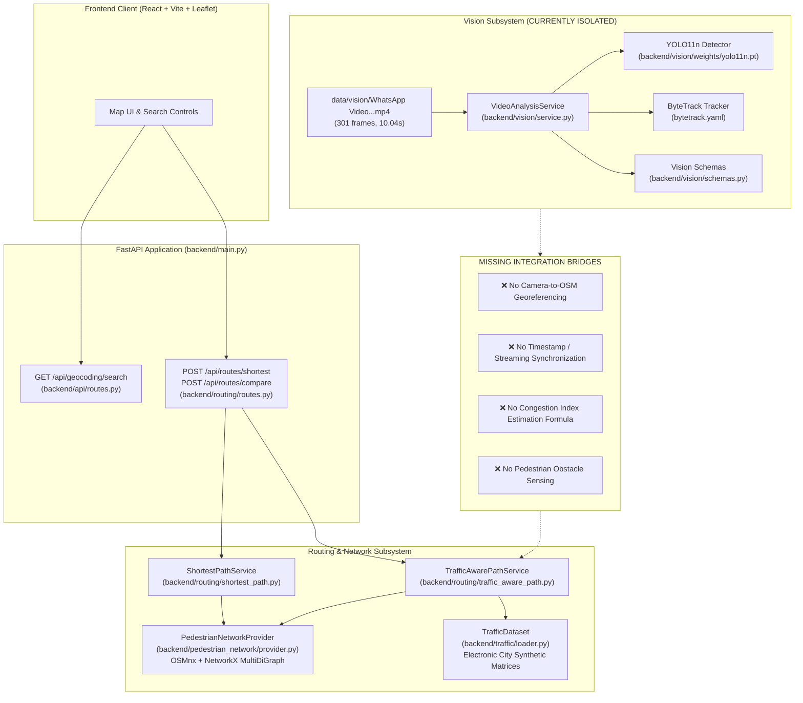
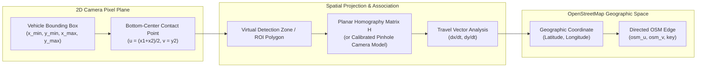
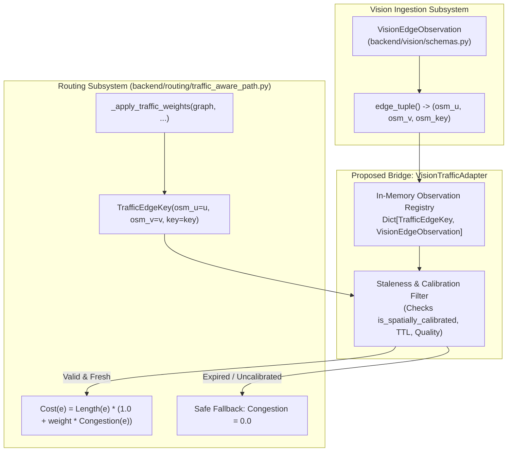
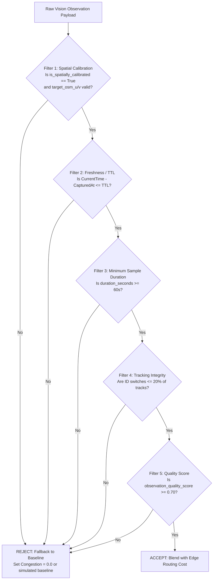
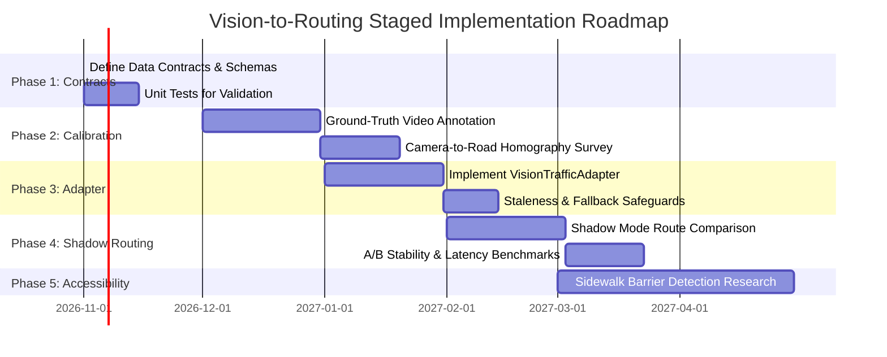
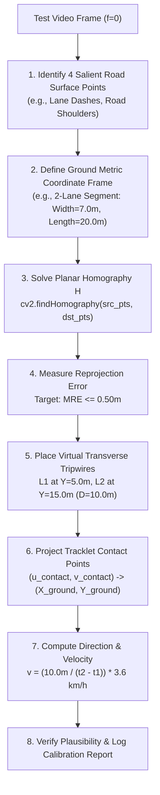

# Vision-to-Routing Integration Plan: Architecture, Data Contracts, and Research Roadmap

**Project Title:** AI-Based Accessibility and Traffic-Aware Route Recommendation for Public Spaces Using Computer Vision  
**Document Path:** `research/vision_routing_integration_plan.md`  
**Date:** October 2026  
**Audience:** Academic Pair Programming, Research Evaluation, and Systems Engineering  

---

## Executive Summary

The **AccessRoute** system currently features two distinct, operational subsystems:
1. A **Pedestrian and Traffic-Aware Routing Engine** (`backend/routing/`, `backend/pedestrian_network/`, and `backend/traffic/`) that downloads OpenStreetMap (OSM) walking networks and computes optimal pedestrian routes using walking distance penalized by a synthetic traffic congestion index.
2. A **Computer Vision Perception Module** (`backend/vision/`) that analyzes traffic video feeds using Ultralytics YOLO11n and ByteTrack to detect and track motorized vehicles (`car`, `motorcycle`, `bus`, `truck`).

**Current Status and Milestones Achieved:**
* **Phase 1 Data Contracts (`backend/vision/schemas.py`):** Fully implemented and validated (`CameraMetadata`, `ObservationTimeEnvelope`, `VisionEdgeObservation`) with strict coordinate bounds, timezone enforcement, and OSM node pairing (173 unit tests).
* **Phase 2 Offline Perception & Post-Processing (`backend/vision/post_processor.py`, `backend/vision/evaluate_pipeline.py`):** Successfully implemented deterministic temporal majority voting for tracklet vehicle-class stability, configurable minimum lifespan filtering (`min_track_lifespan_frames=5`), and a complete offline evaluation reporting suite benchmarked on both a 30-frame sample and the complete 301-frame test video.
* **Phase 3 Vision-to-Traffic Adapter & In-Memory Registry (`backend/traffic/vision_adapter.py`):** Fully implemented and audited. Provides thread-safe observation storage keyed by `TrafficEdgeKey` (and tuple aliases), strict spatial calibration and TTL checks, atomic access, quality thresholds, zero invented congestion values, and 24 passing regression tests in `backend/tests/test_traffic_adapter.py`.

**Integration Gap:**
Despite perception and adapter maturity, **camera observations cannot yet be linked to real-world OpenStreetMap road edges with mathematical validity**. Raw vehicle bounding boxes in 2D pixel coordinates cannot determine real-world vehicle positions or travel directions without surveyed ground-control points and planar homography calibration. Furthermore, vehicle counts cannot be converted into meaningful traffic congestion scores without roadway capacity baselines and speed deficit measurements.

This document defines the next-phase architecture to bridge these subsystems. It specifies:
1. An empirical feasibility audit of the existing test video metadata against `CameraMetadata` requirements.
2. The exact mathematical and physical requirements for camera-to-road ground-plane homography calibration.
3. How camera observations map to exact directed OpenStreetMap edges, including parallel key differentiators and reverse-direction isolation.
4. A minimal, reproducible offline calibration experiment using surveyed ground-control points or controlled road geometry.
5. The directional tripwire crossing mechanism for flow and velocity calculation, and the remaining validation needed before deriving a congestion index.
6. Strict separation between continuous vehicular traffic flow and categorical pedestrian accessibility obstacles.

---

## 1. Current Architecture and Data Flow

### 1.1. System Architecture Overview

The following diagram illustrates the current state of the AccessRoute backend and highlights the existing integration gap between computer vision perception and graph-based routing:



### 1.2. Existing Subsystem Capabilities

1. **Routing Engine (`backend/routing/`):**
   * Uses NetworkX `MultiDiGraph` downloaded via OSMnx for bounded pedestrian networks.
   * Nodes contain coordinates `(y=latitude, x=longitude)`.
   * Directed edges represent walkable segments `(osm_u, osm_v, key)` with physical attributes (`length`, `geometry`, `highway`).
   * Evaluates cost using:
     $$\text{Cost}(e) = \text{Length}(e) \times (1.0 + \text{traffic\_weight} \times \text{Congestion}(e))$$
     where $\text{Congestion}(e) \in [0.0, 1.0]$ is currently queried from synthetic matrices (`backend/traffic/loader.py`). Unmatched edges default safely to $\text{Congestion} = 0.0$.
2. **Computer Vision Module (`backend/vision/`):**
   * Processes sequential video frames using YOLO11n + ByteTrack.
   * Enforces strict bounding box coordinate validation, target class filtering (COCO IDs 2, 3, 5, 7), and persistent tracklet ID management.
   * Operates completely offline/locally without network calls or automatic downloads.
   * **Isolation Status:** Not registered in `backend/main.py`, has no HTTP endpoints, no database tables, and no mapping to geographic graph edges.

---

## 2. Existing Computer-Vision Outputs

The vision module's data contracts are defined in [`backend/vision/schemas.py`](file:///Users/sujalchavan/Documents/AccessRoute/backend/vision/schemas.py). The module yields two primary structured outputs:

### 2.1. Frame-Level Detections (`FrameDetectionResult`)
For each processed frame $f \in [0, N-1]$:
* `frame_number`: Sequential integer index ($0, 1, \dots, 300$).
* `timestamp_seconds`: Relative elapsed time from video start ($0.0 \text{s} \dots 10.04 \text{s}$).
* `detection_count`: Total valid vehicle detections in this frame.
* `detections`: List of `DetectedObject` instances, each comprising:
  * `class_name`: Validated category (`"car"`, `"motorcycle"`, `"bus"`, `"truck"`).
  * `confidence`: Float detection confidence in $[0.0, 1.0]$ ($s \ge 0.50$).
  * `bounding_box`: Pixel coordinates `(x_min, y_min, x_max, y_max)` clamped to frame bounds ($640 \times 360$).
  * `track_id`: Integer trajectory ID assigned by ByteTrack across sequential frames.

### 2.2. Video Analysis Summary (`VideoAnalysisSummary`)
Aggregated across all processed frames:
* `video_name`: Source file identifier.
* `total_frames` & `processed_frames`: Frame count (e.g., 301).
* `duration_seconds` & `fps`: e.g., $10.04\text{s}$ and $29.97\text{ FPS}$.
* `class_counts`: Cumulative per-frame detection events (e.g., car: 1,212, bus: 254, motorcycle: 157, truck: 8).
* `total_detections`: Sum of all detection events across all frames (e.g., 1,631).
* `tracked_id_counts`: Distinct tracker IDs observed per class (e.g., car: 18, bus: 2, motorcycle: 9, truck: 1).
* `total_tracked_ids`: True union of all unique tracker IDs (e.g., 28).
* `disclaimer`: Required warning explicitly disclaiming ground-truth vehicle counts, road congestion, and accessibility barrier validation.

> [!IMPORTANT]
> **Why Raw Outputs Cannot Directly Inform Routing:**  
> 1. `class_counts` measures visual persistence (a stationary car generates 30 detection events per second).  
> 2. `total_tracked_ids` suffers from track fragmentation (1 bus received 2 IDs) and class switching (2 IDs spanned multiple classes).  
> 3. Pixel coordinates `(x, y)` have no intrinsic spatial connection to any latitude/longitude coordinate or road network edge.

---

## 3. Requirements for Associating Camera Observations with OpenStreetMap Segments

To map a 2D bounding box in pixel space $(u, v)$ to a directed OpenStreetMap edge $(u_{\text{osm}}, v_{\text{osm}}, \text{key})$, the system requires an explicit spatial association pipeline.



### 3.1. Camera Metadata Audit: Schema vs. Test Video Reality

[`CameraMetadata`](file:///Users/sujalchavan/Documents/AccessRoute/backend/vision/schemas.py) defines the formal parameters required to ground an observational camera. Below is an exhaustive audit comparing what the schema represents against the empirical data available for `data/vision/WhatsApp Video 2026-10-26 at 9.29.19 AM.mp4`:

| Schema Parameter | Type & Constraints | Status in Test Video | Available Evidence / Reason |
| :--- | :--- | :--- | :--- |
| `camera_id` | `str`, non-empty, max 100 chars | **MISSING** | No camera device ID or sensor registry entry exists in file metadata. |
| `latitude` | `float`, WGS-84 $[-90.0, 90.0]$ | **MISSING** | MP4 container contains zero EXIF/GPS tags; physical location is unrecorded. |
| `longitude` | `float`, WGS-84 $[-180.0, 180.0]$ | **MISSING** | Unrecorded; geographic city, neighborhood, and street are unconfirmed. |
| `elevation_meters` | `float`, $\ge 0.0$ | **MISSING** | Mounting height above ground level is unmeasured. |
| `heading_degrees` | `float`, $[0.0, 360.0)$ | **MISSING** | Compass orientation angle (azimuth) of the camera lens is unmeasured. |
| `tilt_degrees` | `float`, $[-90.0, 90.0]$ | **MISSING** | Pitch/tilt angle is unmeasured (qualitatively observed as downward vantage). |
| `target_osm_u` | `int`, valid OSM node ID | **MISSING** | No OpenStreetMap intersection or node has been surveyed for this footage. |
| `target_osm_v` | `int`, valid OSM node ID | **MISSING** | Paired destination node is completely unknown. |
| `target_osm_key` | `int`, $\ge 0$ (default `0`) | **DEFAULT (0)** | Parallel edge key cannot be verified without target nodes. |
| `is_spatially_calibrated`| `bool` | **FALSE** | No homography transformation or metric calibration has been certified. |

**What IS Measured and Available from the Test Video:**
* **Frame Dimensions:** $640 \times 360$ pixels (16:9 aspect ratio).
* **Frame Count & Duration:** Exactly 301 frames spanning $10.043\text{ seconds}$ at $29.970\text{ FPS}$.
* **Vantage Perspective:** High-angle oblique perspective (second-floor window, pedestrian overpass, or elevated roadside utility pole).
* **Qualitative Road Scene:** Multi-lane urban roadway with bidirectional or divided motorized traffic, including painted lane separators.

### 3.2. Mathematical Formulation: Planar Ground Homography

To project vehicle locations from camera pixel coordinates $(u, v)$ to metric ground plane coordinates $(X, Y)$, a planar projective transformation (homography matrix $H \in \mathbb{R}^{3 \times 3}$) must be established:

$$\begin{bmatrix} X \\ Y \\ 1 \end{bmatrix} \sim H \begin{bmatrix} u \\ v \\ 1 \end{bmatrix} = \begin{bmatrix} h_{11} & h_{12} & h_{13} \\ h_{21} & h_{22} & h_{23} \\ h_{31} & h_{32} & h_{33} \end{bmatrix} \begin{bmatrix} u \\ v \\ 1 \end{bmatrix}$$

Expanding into inhomogeneous Cartesian coordinates:
$$X = \frac{h_{11}u + h_{12}v + h_{13}}{h_{31}u + h_{32}v + h_{33}}, \quad Y = \frac{h_{21}u + h_{22}v + h_{23}}{h_{31}u + h_{32}v + h_{33}}$$

#### 1. Ground Contact Point Association (Critical Requirement)
A 2D bounding box centroid $( (x_1+x_2)/2, (y_1+y_2)/2 )$ corresponds to the optical centroid of a 3D vehicle body, suspended 1.0–2.5 meters above the asphalt. Projecting this centroid via $H$ produces severe parallax errors that distort with vehicle height (e.g. A tall bus appears farther away than a low sports car at the exact same road position).
**Rule:** Projection must strictly use the **bottom-center contact point**:
$$(u_{\text{contact}}, \; v_{\text{contact}}) = \left( \frac{x_{\min} + x_{\max}}{2}, \; y_{\max} \right)$$
where $y_{\max}$ represents the lowest pixel row of the bounding box where the vehicle's tires meet the ground plane.

#### 2. Evidence Needed to Solve Matrix $H$
To solve for the 8 degrees of freedom in $H$ (up to scale factor $h_{33} = 1$), a minimum of **4 non-collinear Ground Control Points (GCPs)** are required:
$$\{(u_i, v_i) \leftrightarrow (X_i, Y_i)\}_{i=1}^N, \quad N \ge 4$$
Acceptable physical sources for GCPs:
1. **Surveyed Road Infrastructure:** Metric distance between surveyed pedestrian crosswalk stripes, stop lines, or physical lane striping intervals (Indian Road Congress / IRC standards specify standard $3.0\text{m}$ stripe, $4.5\text{m}$ gap).
2. **Aerial Orthophoto Cross-Referencing:** Features visible in both the camera frame and high-resolution satellite imagery (e.g., manhole covers, light pole bases, road medians, intersection corners).
3. **Dual Vanishing Points & Metric Line:** Intersection of parallel road lane markings (longitudinal vanishing point $V_{\text{long}}$) and perpendicular road markings (transverse vanishing point $V_{\text{trans}}$), calibrated with at least one known physical distance (e.g. road lane width = $3.5\text{m}$).

#### 3. Verification Criteria
The derived homography $H$ must be evaluated against independent test points not used in fitting:
* **Mean Reprojection Error:** $\text{MRE} = \frac{1}{M} \sum_{j=1}^M \| X_j - \hat{X}_j \|_2 \le 0.50\text{ meters}$.
* **Scale Linearity:** Distances between known physical markers along the roadway must not show non-linear scale drift across the camera's depth field ($y=100$ to $y=360$).

### 3.3. Directed Edge Identification & Graph Key Representation

In OpenStreetMap and NetworkX (`backend/routing/`, `backend/pedestrian_network/`), roadway segments are represented as directed multigraphs (`MultiDiGraph`). Each directed roadway segment is strictly identified by an ordered 3-tuple:
$$(u_{\text{osm}}, \; v_{\text{osm}}, \; \text{key})$$

* **Directed Edge Separation:** A physical two-way street consists of two distinct edges: $(u \to v, 0)$ and $(v \to u, 0)$. Ingesting an observation for forward traffic must never leak into oncoming traffic.
* **Parallel Edge Keys:** Segments that share the same endpoints (e.g., express lanes vs. local service roads, or divided dual carriageways) are distinguished by `key = 0, 1, 2...`.
* **Reverse-Direction Isolation:** `TrafficEdgeKey(u, v, 0)` and `TrafficEdgeKey(v, u, 0)` produce different dictionary hashes. An observation registered for $(u \to v)$ returns `None` and `NOT_FOUND` when queried for $(v \to u)$, ensuring that one-way congestion or lane closures are never misattributed to the opposite direction.

### 3.4. Directional Flow Disambiguation via Dual Transverse Tripwires

In 2D camera coordinates, bounding boxes simply displace across pixels $(\Delta x, \Delta y)$ per frame. To reliably assign an observation to directed edge $(u \to v)$ versus $(v \to u)$:
1. **Region of Interest (ROI) Polygon:** A 4-point convex polygon in image space defining the active roadway surface. Detections outside this polygon (e.g., parked cars in driveways, vehicles on intersecting side streets) are excluded.
2. **Dual Virtual Counting Lines (Tripwires $L_1$ and $L_2$):** Two transverse lines placed across the lane surface within the ROI polygon, separated by a known ground distance $D_{\text{meters}}$.
3. **Intersection Event Detection:** For each tracked vehicle, the trajectory segment of its ground-contact point $P_{t-1} \to P_t$ is tested against $L_1$ and $L_2$ using 2D line-segment intersection:
   * Crossing $L_1$ at timestamp $t_1$, then crossing $L_2$ at timestamp $t_2$ ($t_2 > t_1$) $\implies$ travel in the positive direction $(u \to v)$.
   * Crossing $L_2$ then $L_1$ $\implies$ travel in the reverse direction $(v \to u)$.
4. **Instantaneous Velocity Measurement:**
   $$v_{\text{kmh}} = \left( \frac{D_{\text{meters}}}{t_2 - t_1} \right) \times 3.6$$
5. **Screening Incomplete Trajectories:** Vehicles that stop, park, or turn off before crossing both tripwires are excluded from the through-flow count.

### 3.5. Temporal Reconciliation & Timestamp Handling

A critical gap between video decoding and live traffic routing is timestamp semantics:
* **Video Frame Timestamps:** Offline video processing operates on relative elapsed time ($t = 0.0\text{s} \dots 10.04\text{s}$ at frame index $f$).
* **Real-World Routing Timestamps:** Graph routing requires absolute, timezone-aware UTC timestamps to synchronize with time-of-day traffic matrices or live sensor streams.
* **Synchronization Requirements:**
  1. Capture nodes must synchronize internal clocks via Network Time Protocol (NTP).
  2. Every observation payload must specify timezone-aware UTC timestamps (`start_time` and `end_time` in `ObservationTimeEnvelope`).
  3. The ingestion layer must reject observations exhibiting clock skew ($> 5.0\text{s}$ in the future) or staleness ($\text{Age} > \text{TTL}$, default 15 minutes).
  4. Video duration must match elapsed timestamp difference within a strict tolerance ($| \text{duration} - (t_{\text{end}} - t_{\text{start}}) | \le 1.0\text{s}$).

> [!WARNING]
> **Status in Current Codebase:**  
> The camera location, orientation, mounting height, and target OpenStreetMap road segment for `data/vision/WhatsApp Video 2026-10-26 at 9.29.19 AM.mp4` are **completely unknown and uncalibrated**. No geographic mapping can be safely assumed without ground survey data.

---

## 4. Implemented Data Contracts and Routing Bridge Architecture

### 4.1. Implemented Pydantic Schemas (`backend/vision/schemas.py`)

The Phase 1 data contracts are **fully implemented and verified by 173 unit tests** in `backend/vision/schemas.py`. They enforce strict validation rules:

1. **`CameraMetadata`:**
   * Geographic coordinates: `latitude` $\in [-90.0, 90.0]$, `longitude` $\in [-180.0, 180.0]$ (rejects non-numeric and boolean types).
   * Orientation: `heading_degrees` $\in [0.0, 360.0)$, `tilt_degrees` $\in [-90.0, 90.0]$.
   * Directed road pairing: Enforces that `target_osm_u` and `target_osm_v` must both be provided together, must be distinct integer node IDs, and must be present if `is_spatially_calibrated=True`.
2. **`ObservationTimeEnvelope`:**
   * Timezone awareness: Requires timezone-aware UTC datetimes (`start_time`, `end_time`).
   * Temporal order: Enforces `end_time > start_time`.
   * Duration consistency: Enforces `duration_seconds > 0.0` and matches elapsed time within $1.0\text{s}$ tolerance.
   * Staleness control: `time_to_live_seconds` (default $900.0\text{s} = 15\text{ mins}$, $\ge 60.0\text{s}$).
3. **`VisionEdgeObservation`:**
   * Directed edge identification: `osm_u: int`, `osm_v: int`, `osm_key: int` (with `edge_tuple()` returning `(osm_u, osm_v, osm_key)`).
   * Deduplicated vehicle counts: Nonnegative counts `unique_vehicles_observed` and per-class breakdown `vehicles_by_class`.
   * Unvalidated indicator disclaimer: `experimental_congestion_index` $\in [0.0, 1.0]$ explicitly documented as an unvalidated research prototype.

### 4.2. Connection to Existing Routing and Traffic Subsystem

The data contracts map directly to the existing routing engine architecture:



* **Direct Key Alignment:**
  In `backend/traffic/loader.py`, edges are indexed by:
  ```python
  @dataclass(frozen=True)
  class TrafficEdgeKey:
      osm_u: int
      osm_v: int
      key: int = 0
  ```
  `VisionEdgeObservation.edge_tuple()` returns `(osm_u, osm_v, osm_key)`, which directly instantiates `TrafficEdgeKey(osm_u, osm_v, osm_key)`.
* **Routing Lookup Hook:**
  In `backend/routing/traffic_aware_path.py` (lines 318–337), `_apply_traffic_weights()` evaluates:
  ```python
  traffic_key = TrafficEdgeKey(osm_u=int(u), osm_v=int(v), key=int(key))
  ```
  A future `VisionTrafficAdapter` can be queried at this exact point:
  ```python
  congestion = vision_adapter.get_congestion(traffic_key, current_time=eval_time)
  if congestion is None:
      # Fall back safely to synthetic dataset or 0.0
      congestion = baseline_dataset.get_congestion(traffic_key, time_index) or 0.0
  ```

### 4.3. Gap Analysis: Implemented Modules vs. Design Proposals

The following table distinguishes what has been verified and merged in code versus what remains a forward-looking design proposal:

| Component / Capability | Status | Artifact / Path | Verification Status |
| :--- | :--- | :--- | :--- |
| **YOLO11n + ByteTrack Perception** | **Implemented** | `backend/vision/service.py` | Verified on test video (1,631 raw boxes, 28 tracks) |
| **Tracklet Post-Processor (Majority Voting)** | **Implemented** | `backend/vision/post_processor.py` | Verified (smoothed 2 oscillating tracks; 9 detections) |
| **Lifespan Filtering (`min_lifespan=5`)** | **Implemented** | `backend/vision/post_processor.py` | Verified (pruned 4 short tracks; 12 detections) |
| **Offline Evaluation CLI** | **Implemented** | `backend/vision/evaluate_pipeline.py` | Verified with full-video mode (`--max-frames` optional) |
| **Data Contracts (`CameraMetadata`, etc.)** | **Implemented** | `backend/vision/schemas.py` | Verified with 173 passing unit tests |
| **`VisionTrafficAdapter` In-Memory Registry** | **Implemented & Audited** | `backend/traffic/vision_adapter.py` | **Verified with 24 passing unit tests** (thread-safe, TTL, atomic) |
| **Pedestrian Graph Routing Engine** | **Implemented** | `backend/routing/traffic_aware_path.py` | Verified over OSMnx `MultiDiGraph` with Dijkstra |
| **Synthetic Traffic Matrix Loading** | **Implemented** | `backend/traffic/loader.py` | Verified with Electronic City 2D matrices |
| **Camera Spatial Homography Calibration** | *Design Proposal* | Missing for sample video | **Uncalibrated** (camera height, pitch, $H$ matrix unknown) |
| **Directional Tripwire Crossing in Service** | *Design Proposal* | Proposed in Section 3.4 | Not yet integrated into sequential video service |
| **Live UTC Ingestion REST API Endpoint** | *Design Proposal* | Proposed for Phase 5 | No `/api/vision/observations` route exists yet |
| **Empirical Roadway Capacity ($C_{\text{ref}}$)** | *Design Proposal* | Proposed in Section 5 | Unknown; requires civil/traffic survey data |
| **Pedestrian Accessibility Obstacle Sensing** | *Design Proposal* | Proposed in Section 7 | Completely separate; requires dedicated segmentation |

---

## 5. Flow-Rate vs. Congestion Index: Theoretical Formulation & Validation Requirements

The existing routing cost function in `backend/routing/traffic_aware_path.py` (line 37) is formulated as:
$$\text{Cost}(e) = \text{Length}(e) \times (1.0 + \text{traffic\_weight} \times \text{Congestion}(e))$$
where $\text{Congestion}(e) \in [0.0, 1.0]$.

### 5.1. Why Vehicle Flow Rate $\ne$ Traffic Congestion (The Fundamental Diagram of Traffic)
In classical traffic flow theory (Lighthill-Whitham-Richards and Greenshields models), traffic flow $q$ (vehicles/hour) is the product of spatial vehicle density $k$ (vehicles/km) and mean speed $v$ (km/h):
$$q = k \times v$$

The relationship between flow $q$ and density $k$ is non-linear and parabolic (**The Fundamental Diagram of Traffic Flow**). This creates a fatal ambiguity if congestion is inferred solely from vehicle flow or detection counts:
* **Low Flow State A (Free-Flow):** Vehicles travel rapidly at the free-flow speed limit $v_{\text{free}}$ with low density $k \approx 0$. Flow rate $q$ is low, and congestion is genuinely near $0.0$.
* **Low Flow State B (Gridlock / Jam Density):** Vehicles are packed bumper-to-bumper at jam density $k_{\text{jam}}$. Movement slows to a crawl or full stop ($v \approx 0$). Consequently, flow rate $q$ drops toward $0$.

> [!CAUTION]
> **The Gridlock Fallacy:**  
> If an algorithm naively maps low vehicle crossing counts directly to low congestion, **a completely gridlocked street with stationary traffic would be misclassified as empty and free-flowing** ($\text{Congestion} \approx 0.0$). Pedestrians routed across this street would encounter severe vehicular blockage and crossing danger.

### 5.2. Proposed Composite Experimental Congestion Indicator
To eliminate this ambiguity, a defensible congestion indicator must combine both **throughput flow** and **speed deficit**:

$$\text{Congestion}_{\text{vision}}(e) = \max\left(\text{Congestion}_{\text{flow}}(e), \; \text{Congestion}_{\text{speed}}(e)\right)$$

Where:
1. **Flow Congestion Ratio:**
   $$\text{Congestion}_{\text{flow}}(e) = \min\left(1.0, \; \frac{\text{InflowRate}_{\text{obs}}(e)}{\text{Capacity}_{\text{ref}}(e)}\right)$$
   * $\text{InflowRate}_{\text{obs}}(e) = \frac{\text{UniqueScreenedVehicles}(e)}{\Delta t_{\text{minutes}}}$: Rate of vehicles crossing both directional tripwires.
   * $\text{Capacity}_{\text{ref}}(e)$: Design saturation flow rate for the road classification (`highway=primary`, `secondary`, `residential`).
2. **Speed Deficit Ratio (Detects Jam Density & Queues):**
   $$\text{Congestion}_{\text{speed}}(e) = \max\left(0.0, \; \frac{v_{\text{free}}(e) - v_{\text{obs}}(e)}{v_{\text{free}}(e)}\right)$$
   * $v_{\text{free}}(e)$: Posted speed limit or baseline free-flow speed from OpenStreetMap (`maxspeed` tag, e.g., $50\text{ km/h}$).
   * $v_{\text{obs}}(e)$: Mean vehicle speed computed across valid tripwire transit times: $v_{\text{obs}} = \frac{1}{M} \sum_{m=1}^M \left( \frac{D}{t_{2,m} - t_{1,m}} \cdot 3.6 \right)$.

### 5.3. Blending Vision with the Baseline
When a calibrated, fresh vision observation exists for segment $e$, it can be blended with the static simulated baseline $\text{Congestion}_{\text{sim}}(e)$:
$$\text{Congestion}_{\text{fused}}(e) = (1 - \alpha) \cdot \text{Congestion}_{\text{sim}}(e) + \alpha \cdot \text{Congestion}_{\text{vision}}(e)$$
Where $\alpha \in [0.0, 1.0]$ is an adaptive trust weight determined by observation freshness and quality:
$$\alpha = \text{QualityScore} \times \max\left(0.0, \; 1.0 - \frac{\text{AgeSeconds}}{\text{TTL}}\right)$$

> [!CAUTION]
> **Explicit Research Status:**  
> * **Road Capacity Values ($\text{Capacity}_{\text{ref}}$) are UNKNOWN** in the current project and require empirical traffic engineering surveys.  
> * **The formula above is an UNVALIDATED HYPOTHESIS** and must NOT be deployed into production routing without field calibration and error bounds testing.

---

## 6. Rules for Rejecting Stale, Incomplete, or Unreliable Observations

To ensure that computer vision errors never compromise pedestrian routing reliability, the integration layer must enforce five mandatory rejection filters:



### 6.1. Rejection Criteria

1. **Spatial Validation Filter:** If `is_spatially_calibrated` is `False`, or if `target_osm_u` / `target_osm_v` do not correspond to an edge present in the active pedestrian graph, reject immediately.
2. **Temporal Staleness Filter:** Real-world traffic is highly dynamic. If an observation's age exceeds its Time-To-Live ($\text{TTL} = 15\text{ minutes}$), it must be dropped.
3. **Minimum Sampling Window:** A 10-second video sample is statistically erratic (a single traffic light cycle can show 0 vehicles followed by 20 vehicles in bursts). Observations shorter than a minimum sampling duration ($T_{\text{min}} = 60\text{ seconds}$) must be rejected for routing cost modification.
4. **Tracking Quality & Class Instability Filter:** If the multi-class count exceeds the unique tracker union by more than 20% ($\sum |S_c| - |\bigcup S_c| > 0.20 \cdot |\bigcup S_c|$), tracking fragmentation is too severe to yield a reliable vehicle count.
5. **Fail-Safe Fallback Guarantee:** Whenever an observation is rejected, the routing system must silently fall back to the physical walking distance cost ($\text{Congestion} = 0.0$ or existing synthetic baseline). **A sensor failure or computer vision crash must never cause a routing request to fail.**

---

## 7. Separate Approach for Pedestrian Accessibility Obstacle Detection

A critical architectural distinction in AccessRoute is the separation of **vehicular traffic sensing** from **pedestrian accessibility sensing**:

| Dimension | Vehicular Traffic Perception (Current Module) | Pedestrian Accessibility Perception (Future Requirement) |
| :--- | :--- | :--- |
| **Monitored Domain** | Roadway motorized lanes | Sidewalks, walking paths, curbs, crosswalks |
| **Target Entities** | Cars, buses, trucks, motorcycles | Curb ramps, stairs, tactile paving, construction scaffolding, sidewalk width, surface roughness |
| **Impact on Pedestrian** | Crossing safety, noise, delay at street crossings | Mobility barrier (e.g., wheelchair impassable, tripping hazard) |
| **Model Type** | Object Detection + MOT Tracking (YOLO11n + ByteTrack) | Semantic Segmentation + Multi-Label Classification |
| **Sensor Vantage** | Elevated roadside / pole traffic camera | Pedestrian-level perspective (smartphone, body-worn, low-angle sidewalk camera) |
| **Ground Truth Source** | Vehicle traffic counts | Americans with Disabilities Act (ADA) / accessibility standards |

### 7.1. Architectural Strategy for Accessibility Barriers
1. **Dedicated Pipeline:** Do not attempt to repurpose the vehicle detector for accessibility obstacles. Develop a dedicated, fine-tuned segmentation model (e.g., YOLO11-seg or SegFormer trained on Cityscapes, Mapillary Vistas, or custom sidewalk datasets).
2. **Discrete Edge Attributes:** Accessibility barriers attach directly to pedestrian graph edges as categorical constraints (e.g., `has_curb_ramp: bool`, `step_count: int`, `min_width_meters: float`).
3. **Routing Filter vs. Cost Impedance:** Unlike traffic (which acts as a continuous time impedance), accessibility obstacles act as **hard traversal constraints** (e.g., if a wheelchair user requests a step-free route, any edge with `step_count > 0` must have cost set to $\infty$, completely excluding it from Dijkstra/A* exploration).

---

## 8. Phased Implementation Plan with Acceptance Criteria and Tests

To ensure disciplined software engineering, the integration of vision observations must proceed in five staged phases:



### Phase 1: Data Contracts and Safety Schemas (STATUS: COMPLETED & VERIFIED)
* **Goal:** Create standardized Pydantic schemas in `backend/vision/schemas.py` for camera metadata, observation envelopes, and edge mapping without altering routing code.
* **Delivered Artifacts:** `CameraMetadata`, `ObservationTimeEnvelope`, and `VisionEdgeObservation` in `backend/vision/schemas.py`.
* **Verification:** Unit tests in `backend/tests/test_vision.py` verifying coordinate bounds, timezone enforcement, duration consistency, and paired OSM node IDs.

### Phase 2: Offline Tracklet Post-Processing & Evaluation (STATUS: COMPLETED & VERIFIED)
* **Goal:** Stabilize vehicle-class predictions and filter short-lived spurious tracks from raw video inference.
* **Delivered Artifacts:** `TrackletPostProcessor` (`backend/vision/post_processor.py`) with deterministic majority voting and minimum lifespan filtering; standalone CLI evaluation tool (`backend/vision/evaluate_pipeline.py`).
* **Verification:** Evaluated on both 30-frame conservative sample (`data/vision/evaluation_sample_30frames.txt`) and full 301-frame test video (`data/vision/evaluation_full_video.txt`). Verified 173 unit tests in `backend/tests/test_vision.py`.

### Phase 3: Vision-to-Traffic Adapter & In-Memory Registry (STATUS: COMPLETED & AUDITED)
* **Goal:** Implement an in-memory observation registry and adapter (`VisionTrafficAdapter` in `backend/traffic/vision_adapter.py`) implementing the traffic query protocol.
* **Delivered Artifacts:** `VisionTrafficAdapter` and `ObservationValidationStatus` in `backend/traffic/vision_adapter.py`, integrated into `backend/traffic/__init__.py`.
* **Verification & Audit:**
  * In-memory thread-safe registry guarded by `threading.RLock()`.
  * Keyed by frozen `TrafficEdgeKey(osm_u, osm_v, key)` and supports tuple aliases `(u, v)` / `(u, v, key)`.
  * Enforces spatial calibration checks, configurable TTL staleness, clock-skew protection, and quality score filtering.
  * Atomic status evaluation and retrieval via `_evaluate_observation_under_lock()`.
  * Zero invented congestion: returns `None` when `experimental_congestion_index` is missing or uncalibrated, guaranteeing safe fallback.
  * Verified by **24 unit tests** in `backend/tests/test_traffic_adapter.py` passing with 100% success.

### Phase 4: Camera Georeferencing, Planar Homography, and Directional Tripwires (STATUS: NEXT ACTIONABLE PHASE)
* **Goal:** Establish formal spatial ground-to-camera calibration and directional tripwire flow estimation.
* **Key Tasks:**
  1. Measure or survey physical camera mounting coordinates $(\text{lat}, \text{lon}, \text{elevation})$ and compass heading $\theta$.
  2. Identify at least 4 ground-control points (GCPs) and calculate planar homography matrix $H$ mapping pixel contact points $(u, v)$ to metric roadway coordinates $(X, Y)$.
  3. Implement dual transverse tripwire crossing logic in `TrackletPostProcessor` to disambiguate directed edge travel $(u \to v)$ vs. $(v \to u)$ and measure crossing velocity.
* **Acceptance Criteria:**
  * Detections outside the roadway ROI polygon are rejected.
  * Travel direction strictly assigned to the correct directed OSM edge $(u_{\text{osm}}, v_{\text{osm}}, \text{key})$.
  * Reprojection error $\le 0.50\text{ meters}$.
  * Measured vehicle velocities fall within physically plausible bounds ($10\text{ km/h} \dots 80\text{ km/h}$).
* **Required Tests:** Geometry and projection unit tests in `backend/tests/test_calibration.py`.

#### 8.1. Proposed Minimal Offline Calibration Experiment Protocol
Before building a production camera georeferencing pipeline, a small, reproducible offline calibration experiment must be conducted on the existing test video:



1. **Step 1: Ground Control Point Annotation:** Identify 4 visible, static roadway features in frame 0 of the test video (e.g. four corners of a lane striping rectangle or curb boundary).
2. **Step 2: Metric Ground Coordinate Assignment:**
   * $P_1 = (0.0\text{m}, 0.0\text{m})$ (near-left lane boundary)
   * $P_2 = (7.0\text{m}, 0.0\text{m})$ (near-right lane boundary, assuming standard 2-lane width = $7.0\text{m}$)
   * $P_3 = (7.0\text{m}, 20.0\text{m})$ (far-right lane boundary, 20m downstream)
   * $P_4 = (0.0\text{m}, 20.0\text{m})$ (far-left lane boundary, 20m downstream)
3. **Step 3: Homography Estimation:** Compute $H$ using OpenCV `cv2.findHomography()`. Compute inverse homography $H^{-1}$.
4. **Step 4: Contact-Point Trajectory Projection:** For retained tracks (e.g., Track #3 car, Track #18 bus), project bottom-center bounding box points $(u_{\text{contact}}, v_{\text{contact}})$ into ground space across all observed frames.
5. **Step 5: Tripwire Crossing & Velocity Extraction:**
   * Evaluate intersection of $(X_t, Y_t)$ trajectories across $L_1 (Y=5.0\text{m})$ and $L_2 (Y=15.0\text{m})$.
   * Determine transit duration $\Delta t = t_2 - t_1$.
   * Verify whether calculated velocity $v = \frac{10.0\text{m}}{\Delta t} \times 3.6$ yields realistic urban vehicular speeds ($20\text{ km/h} \dots 60\text{ km/h}$). If speeds are wildly distorted (e.g. $< 2\text{ km/h}$ or $> 200\text{ km/h}$), the assumed ground scale is falsified.

### Phase 5: Shadow Routing Integration and Verification
* **Goal:** Connect `VisionTrafficAdapter` to `TrafficAwarePathService` in "shadow mode" (dual-evaluation where routes are calculated with and without vision weights to measure variance and verify route stability).
* **Acceptance Criteria:**
  * Sub-millisecond routing lookup overhead ($< 5\text{ms}$).
  * Zero routing failures or HTTP 500 crashes caused by vision inputs.
* **Required Tests:** Integration tests in `backend/tests/test_traffic_aware_path.py` comparing baseline vs. vision-adjusted route candidates.

### Phase 6: Dedicated Accessibility Barrier Sensing Module
* **Goal:** Develop a dedicated computer vision pipeline for sidewalk accessibility obstacles and integrate categorical wheelchair/step-free traversal filters into `backend/routing/`.
* **Acceptance Criteria:**
  * Curb ramp and step detection validated against independent pedestrian datasets.
  * Wheelchair routing guarantees zero steps when step-free mode is enabled.
* **Required Tests:** Component tests in `backend/tests/test_accessibility_routing.py`.

---

## 9. Ground-Truth Collection and Evaluation Methods

To bridge the gap between experimental tracker counts (28–29 IDs) and physical reality, a rigorous ground-truth evaluation protocol must be conducted:

### 9.1. Manual Ground-Truth Annotation Protocol
1. **Tooling:** Use an open-source video annotation tool (e.g., CVAT — Computer Vision Annotation Tool).
2. **Annotation Rules:**
   * Annotate every vehicle bounding box on all 301 frames.
   * Maintain consistent vehicle IDs across frames (human visual re-identification).
   * Record exact frame of entry and frame of departure.
   * Assign definitive vehicle classes (`car`, `motorcycle`, `bus`, `truck`) based on human visual inspection.

### 9.2. Quantitative Evaluation Metrics
The computer vision pipeline must be evaluated against ground truth using standard MOT (Multiple Object Tracking) benchmarks:
* **MOTA (Multiple Object Tracking Accuracy):**
  $$\text{MOTA} = 1 - \frac{\sum (\text{False Negatives} + \text{False Positives} + \text{ID Switches})}{\sum \text{Ground Truth Objects}}$$
* **MOTP (Multiple Object Tracking Precision):** Average bounding box overlap (IoU) for matched tracks.
* **IDF1 Score:** Harmonic mean of trajectory identification precision and recall.
* **ID Switch Count (IDSW):** Number of times a single vehicle is assigned a new tracking ID.
* **Traffic Inflow Error:** Percentage error between automated vehicle count and human ground-truth count:
  $$\text{Count Error} = \left| \frac{\text{Tracked IDs} - \text{True Physical Vehicles}}{\text{True Physical Vehicles}} \right| \times 100\%$$

---

## 10. Research Limitations and Unresolved Questions

For academic integrity, the following fundamental limitations must be explicitly declared in all project publications and deliverables:

1. **Short Observation Duration:** The sample video is approximately **10.04 seconds long** (301 frames). It represents an instantaneous snapshot and cannot be extrapolated to infer 24-hour traffic cycles, peak-hour congestion trends, or long-term urban mobility.
2. **Single Camera Vantage Point:** Observations from one fixed camera perspective suffer from perspective foreshortening, occlusions by large vehicles, and localized blind spots. Citywide traffic routing requires a distributed network of sensors.
3. **Absence of Roadway Calibration:** The camera location, heading, tilt, and targeted OpenStreetMap road segment for `road_trafifc.mp4` / `WhatsApp Video` are **currently uncalibrated and unknown**.
4. **Unvalidated Congestion Formula:** The formula translating vehicle count to a $[0.0, 1.0]$ congestion index is an **unvalidated academic proposal**. True congestion indices require empirical calibration against roadway design capacity and traffic flow theory.
5. **Separation of Accessibility from Traffic:** Motorized vehicle tracking provides **zero information regarding sidewalk accessibility, curb ramps, or pedestrian obstacles**. Accessibility routing requires dedicated sensor inputs and ground-truth validation.

---
*Document authored for the AccessRoute Research Repository.*
